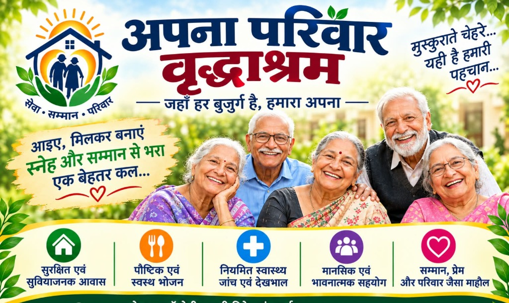

<div align="center">


# 🧓 Apna Parivar Vriddh Aashram Foundation
### अपना परिवार वृद्ध आश्रम फाउंडेशन
**सेवा • सम्मान • परिवार | Dedicated to Dignity, Care, Health & Love for Senior Citizens**

[](https://apnaparivarvriddhaashram.org)
[](https://apnaparivarvriddhaashram.org)
[](#-multilingual-support)
[](#-contact--location-details)
[](LICENSE)

<br/>



<br/>
<br/>

### 🛠️ Built With Modern Full-Stack Technologies

[](https://nextjs.org/)
[](https://react.dev/)
[](https://nodejs.org/)
[](https://expressjs.com/)
[](https://www.mongodb.com/)
[](https://redux-toolkit.js.org/)
[](https://tailwindcss.com/)
[](https://axios-http.com/)
[](https://jwt.io/)

<p align="center">
  <b>🌐 Dynamic NGO Website • 💻 Enterprise NGO Management Software • 💳 Online Donation & 80G Tax Exemption • 🆔 QR Membership ID Cards • 📄 Certificate & Appointment Letter Generator</b>
</p>

[Key Features](#-key-platform-features) •
[Technologies Used](#-technologies-used) •
[Website Architecture](#-sitemap--page-structure) •
[Portals & Panels](#-portals--access-roles) •
[Setup Guide](#-installation--setup-guide) •
[Contact Details](#-contact--location-details)

---

</div>

## 📌 Executive Summary & Project Overview

**Apna Parivar Vriddh Aashram Foundation** (*अपना परिवार वृद्ध आश्रम फाउंडेशन*) is a charitable non-profit institution located in Jabalpur, Madhya Pradesh (affiliated with **ZDC Welfare Foundation**). The foundation is dedicated to providing elder care with five foundational pillars:

1. 🏠 **सुरक्षित एवं सुविधाजनक आवास** — Safe, sanitary, and assisted living accommodation.
2. 🍲 **पौष्टिक एवं स्वस्थ भोजन** — Hygienic, doctor-advised satvik meals and nutrition.
3. 🩺 **नियमित स्वास्थ्य जांच एवं देखभाल** — 24x7 medical assistance, health camps, and medicine supply.
4. 👥 **मानसिक एवं भावनात्मक सहयोग** — Loving companionship, recreational activities, and spiritual satsang.
5. ❤️ **सम्मान, प्रेम और परिवार जैसा माहौल** — Restoring dignity, self-respect, and family warmth to every senior citizen.

This repository powers the official full-stack digital ecosystem for the foundation, combining a public engagement web portal, a donation and tax-receipt generation system, an internal NGO ERP management suite, and automated ID/certificate generators.

---

## 🏛️ Organization Profile & Metadata

| Attribute | Details |
| :--- | :--- |
| **Organization Name** | Apna Parivar Vriddh Aashram Foundation |
| **Hindi Name** | अपना परिवार वृद्ध आश्रम फाउंडेशन |
| **Motto / Slogan** | सेवा • सम्मान • परिवार ("जहाँ हर बुजुर्ग है, हमारा अपना") |
| **Affiliation / Parent Unit** | ZDC Welfare Foundation |
| **Headquarters Address** | Jay Prakash Nagar, Adhartal, Jabalpur, Madhya Pradesh - 482001, India |
| **Primary Contact Nos.** | `+91 8959055269` / `+91 7879071109` |
| **Official Email** | [apnaparivarvriddhaashramfounda@gmail.com](mailto:apnaparivarvriddhaashramfounda@gmail.com) |
| **Official Domain** | [apnaparivarvriddhaashram.org](https://apnaparivarvriddhaashram.org) |
| **Geographic Location** | Adhartal, Jabalpur, MP (Pin: 482001) |
| **Languages Supported** | Hindi (हिन्दी) & English (EN) |

---

## 🛠️ Technologies Used

The project is built on the modern, scalable **MERN + Next.js stack** optimized for high performance, mobile responsiveness, fast indexing (SEO), and data security:

### 1. Frontend Architecture
* **[Next.js](https://nextjs.org/) (v14+)**: Server-Side Rendering (SSR) & Static Site Generation (SSG) for rapid page loads, metadata management, and optimal search engine indexing.
* **[React.js](https://react.dev/) (v18+)**: Component-driven reactive user interface with hooks and reusable UI component primitives.
* **[Tailwind CSS](https://tailwindcss.com/)**: Modern utility-first CSS framework for clean design, responsive grids, custom brand color tokens, and smooth micro-animations.
* **[Redux Toolkit](https://redux-toolkit.js.org/)**: Centralized global state management handling donor sessions, multi-step donation wizards, user credentials, and UI theme states.
* **[Axios](https://axios-http.com/)**: Promise-based HTTP client equipped with request/response interceptors for JWT token injection and centralized error handling.
* **[Lucide React](https://lucide.dev/) / React Icons**: Lightweight, aesthetic icons for modern UI controls.
* **[Framer Motion](https://www.framer.com/motion/)**: Fluid animations and interactive transitions for an engaging donor and visitor experience.

### 2. Backend & API Services
* **[Node.js](https://nodejs.org/)**: Event-driven asynchronous JavaScript runtime powering the server backend.
* **[Express.js](https://expressjs.com/)**: Fast, minimalist web framework providing secure RESTful API endpoints, middleware pipelines, and controllers.
* **[JWT (JSON Web Tokens)](https://jwt.io/)**: Encrypted, stateless authentication for Admin, Staff, Member, and Volunteer logins.
* **[Bcrypt.js](https://www.npmjs.com/package/bcryptjs)**: Salted password hashing ensuring enterprise-grade credential security.
* **[Multer](https://github.com/expressjs/multer)**: Multipart form data middleware for uploading audited reports, resident KYC, and gallery media.
* **[CORS & Helmet](https://helmetjs.github.io/)**: HTTP header security against cross-site scripting (XSS), clickjacking, and unauthorized origins.

### 3. Database & Storage
* **[MongoDB](https://www.mongodb.com/)**: High-performance NoSQL document database ideal for dynamic NGO records, flexible forms, and audit trails.
* **[Mongoose ODM](https://mongoosejs.com/)**: Schema-based modeling with validation rules, relationships, indexing, and automated timestamps.
* **[Cloudinary / AWS S3](https://cloudinary.com/)**: Cloud-hosted media pipeline for resident photos, activity videos, and downloadable annual audit balance sheets.

### 4. Specialized NGO Modules & Automation Engines
* **Payment Gateways**: **Razorpay** / **Cashfree** / **Stripe** + Dynamic **UPI QR Generator** (PhonePe, Google Pay, Paytm, BHIM).
* **Document & PDF Generator**: **`pdf-lib` / `jspdf`** for automatic client/server generation of:
  * Official **80G Tax Exemption Receipts** with donor PAN and digital signature.
  * Verifiable **Volunteer & Service Certificates**.
  * Official **Appointment Letters** for executive members.
* **Anti-Tampering QR Engine**: **`qrcode`** library producing encrypted dynamic QR codes on digital membership cards with real-time verification URLs.
* **Notification Pipelines**:
  * **Nodemailer / SendGrid** for instant donation receipts and PDF delivery over email.
  * **WhatsApp Cloud API / Webhook** for automated WhatsApp donation receipts and event broadcasts.
* **Excel Data Processing**: **`xlsx` (SheetJS)** for exporting donor transaction logs, member rosters, and importing offline camp participant lists.
* **Dual Language Localization (i18n)**: Integrated bilingual content switcher for Hindi (हिन्दी) & English.

---

## ⭐ Key Platform Features

### 1. 🌐 Public Experience & Core Web Features
* **Dual Language Switcher (Hindi & English)**: Complete UI localization catering to local residents, national donors, and overseas contributors.
* **Mobile First & Ultra-Responsive**: Designed with modern UI/UX aesthetics, buttery smooth micro-animations, accessible typography, and fast loading speeds.
* **Direct Communication Hooks**:
  * Floating **WhatsApp Chat Assistant** for instant interaction.
  * Direct **Click-to-Call** hotlines (`+91 8959055269`, `+91 7879071109`).
  * Interactive **Google Maps Embed** for physical visitation and donation drop-offs.
  * Live **Dynamic Social Media feeds** (YouTube, Facebook, Instagram, Twitter/X, LinkedIn).
* **SEO Optimized & Open Graph Ready**: Structured JSON-LD schema for NGOs, local SEO optimization for Jabalpur / MP elder care search queries.

### 2. 💳 Donation & Fundraising Management System
* **Multi-Gateway Payment Integration**: Support for Razorpay / Cashfree / Stripe with Credit/Debit Cards, Net Banking, and Wallets.
* **Instant Dynamic UPI & QR Code Generator**: Donors can scan and pay via PhonePe, Google Pay, Paytm, BHIM, or any UPI app.
* **Cause-Based & Program Donations**:
  * *Sponsor an Elder's Monthly Food & Nutrition*
  * *Medical & Healthcare Emergency Fund*
  * *Winter Clothing & Bedding Drive*
  * *Infrastructure & Aashram Expansion Fund*
  * *Tithi Bhoj / Birthday / Memorial Feast Sponsorship*
* **Instant 80G Tax Exemption Receipts**: Automated generation of PDF receipts containing unique serial numbers, donor PAN, and digital stamps.
* **Transparent Donor Hall of Fame**: Optional public acknowledgment of patron contributions.

### 3. 👥 Membership, Volunteer & Staff Management
* **Self-Service Portals**: Separate secure authentication for Donors, Volunteers, and Life Members.
* **Digital QR Membership ID Card Generator**:
  * Real-time generation of PVC-card styled digital IDs.
  * Embedded secure dynamic QR code linking to cloud verification page to avoid counterfeiting.
* **Automated Certificate & Document Engine**:
  * Volunteer Appreciation Certificates with verifiable verification tokens.
  * Official Appointment Letters for Foundation Office Bearers.
  * Pre-embedded encrypted Digital Signatures & Foundation Seal.

### 4. 📅 Campaigns, Events & Media Coverage
* **Events & Health Camps Portal**: Public calendar for upcoming free medical checkups, Bhajan Sandhyas, yoga workshops, and festivals.
* **Event Attendee Pre-Registration**: Online RSVP and volunteer duty sign-up.
* **Media Gallery**: High-definition albums for resident activities, festival celebrations, and video testimonials.
* **News & Editorial Blog**: Regular updates, rehabilitation success stories, and press releases.

### 5. 🔐 Governance, Compliance & Trust Center
* **Annual & Financial Audit Reports Repository**: Direct public downloads of audited balance sheets, Form 10B, and annual progress reports.
* **Public Grievance & Help Desk**: Feedback, citizen inquiries, and complaint tracking with unique ticket IDs.
* **CSR & Institutional Partnership Desk**: Dedicated portal for Corporate Social Responsibility funding proposals and corporate visits.
* **Internship & Social Work Career Portal**: Application system for MSW (Master of Social Work) students and community fellows.

---

## 🎛️ Portals & Access Roles

```mermaid
graph TD
    A[Apna Parivar Vriddh Aashram Platform] --> B[Public Web Visitors]
    A --> C[Donor Dashboard]
    A --> D[Volunteer & Member Portal]
    A --> E[Secure Admin Panel]

    B --> B1[Browse Stories & Aashram Info]
    B --> B2[Make Online / UPI QR Donation]
    B --> B3[Register for Events / Volunteer]
    B --> B4[View Transparency & Audit Reports]

    C --> C1[Profile & Tax PAN Details]
    C --> C2[Donation History & Ledger]
    C --> C3[Download 80G Tax Receipts PDF]
    C --> C4[Recurring Pledge Management]

    D --> D1[Personal Profile Verification]
    D --> D2[Download Digital QR ID Card]
    D --> D3[Assigned Tasks & Service Hours]
    D --> D4[Download Experience & Appreciation Certificates]

    E --> E1[Role-Based Admin Access RBAC with JWT]
    E --> E2[Financial Accounting & Donation Export Excel/CSV]
    E --> E3[Resident Elder Registry & Medical Tracking]
    E --> E4[Certificate & Appointment Letter Signer]
    E --> E5[Content Management System CMS]
    E --> E6[Database Backup & System Security Logs]
```



### Role Breakdown

| Role | Access Privileges |
| :--- | :--- |
| **Super Admin** | Full access: system configurations, MongoDB database backups, admin user creation, audit logs, master finance. |
| **Manager / Coordinator** | Resident admissions, daily visitor registers, event scheduling, volunteer duty assignments. |
| **Accountant / Treasurer** | Offline donation entries, bank reconciliation, 80G receipt issuance, audit balance sheet updates. |
| **Registered Member** | Access member-only newsletters, verify membership tier, download annual member pass & digital QR ID. |
| **Active Volunteer** | Log volunteer hours, receive notifications on emergency drives, download participation certificates. |
| **Donor / Patron** | View donation ledger, download consolidated annual tax statement, sponsor elder profiles. |

---

## 🗺️ Sitemap & Page Structure

```
├── 🏠 1. Home (मुख्य पृष्ठ)
│   ├── Hero Banner with Live Video & Call to Action
│   ├── Live Metric Counters (Elders Cared, Meals Served, Medical Camps)
│   ├── Urgent Appeal & Direct QR Donation Strip
│   ├── About the Founder & Mission Vision
│   ├── Our Core Care Pillars (Shelter, Healthcare, Nutrition, Recreation)
│   ├── Resident Photo Showcase & Video Stories
│   ├── Recent News, Events & Announcements
│   ├── Testimonials & Patron Reviews
│   └── Interactive Map, Address & WhatsApp Support
│
├── 📖 2. About Us (हमारे बारे में)
│   ├── Our Story & History
│   ├── Mission, Vision & Core Values
│   ├── Board of Trustees & Advisory Council
│   ├── Legal Certifications (Registration, 12A, 80G, CSR-1, PAN)
│   ├── Our Facilities & Living Environment
│   └── Awards & Recognitions
│
├── 👵 3. Elder Care Services (सेवाएं एवं सुविधाएं)
│   ├── 24x7 Residential Shelter & Safe Living
│   ├── Geriatric Healthcare & Regular Doctor Checkups
│   ├── Pure Satvik & Dietician-Curated Meals
│   ├── Physiotherapy & Assisted Mobility
│   ├── Spiritual Satsang, Yoga & Emotional Wellbeing
│   └── Palliative & End-of-Life Dignified Care
│
├── 💖 4. Donate & Support (दान करें एवं सहयोग दें)
│   ├── Instant Online Payment Gateway (Razorpay/Cards/Netbanking)
│   ├── Dynamic UPI QR Code Scanner (GPay / PhonePe / Paytm)
│   ├── Bank Account Details for NEFT / RTGS / IMPS
│   ├── "Sponsor an Elder" Program (Monthly / Annual)
│   ├── Tithi Bhoj / Memorial Meal Booking
│   ├── In-Kind Item Donation Wishlist (Medicines, Groceries, Blankets)
│   ├── 80G Tax Exemption Guide & Instant Receipt Download
│   └── CSR Corporate Partnership Guidelines
│
├── 👥 5. Community & Involvement (जुड़ें एवं सहभागिता)
│   ├── Life Membership Registration Form
│   ├── Volunteer Enrolment Form & Guidelines
│   ├── Internship for Students (Social Work / Nursing / Healthcare)
│   ├── Corporate Team Visits & Day of Service
│   └── Help Desk & Grievance Feedback Form
│
├── 📅 6. Events & Campaigns (गतिविधियां एवं अभियान)
│   ├── Upcoming Free Health Camps & Eye Checkups
│   ├── Festivals & Cultural Celebrations at Aashram
│   ├── Awareness Drives & Senior Citizen Rights Programs
│   └── Event Participation Registration
│
├── 🖼️ 7. Media Gallery & Press (मीडिया एवं समाचार)
│   ├── Categorized Photo Galleries (Living, Healthcare, Festivals)
│   ├── Video Gallery (Interviews, Virtual Tour, Documentaries)
│   ├── Print Media Clippings & Press Coverage
│   └── Official Foundation Newsletter (PDF Archives)
│
├── 📑 8. Transparency & Governance (पारदर्शिता एवं रिपोर्ट)
│   ├── Annual Progress Reports (Year-wise PDF Downloads)
│   ├── Audited Financial Statements & Balance Sheets
│   ├── Statutory Disclosures & Form 10B
│   └── Governance Code & Ethics Policy
│
├── 📞 9. Contact Us (संपर्क करें)
│   ├── Physical Address & Landmark Guide (Adhartal, Jabalpur)
│   ├── Interactive Live Google Map
│   ├── Direct Phone & WhatsApp Tap-to-Chat Buttons
│   ├── Official Query Submission Form
│   └── Emergency Elder Rescue Helpline
│
└── 🔒 10. Portal & Member Areas (लॉगिन पोर्टल)
    ├── Donor Login & 80G Tax Dashboard
    ├── Member Login & QR ID Card Download
    ├── Volunteer Login & Certificate Center
    └── Central Admin Dashboard (ERP)
```

---

## ⚙️ Installation & Setup Guide

### Prerequisites
* **Node.js**: v18.0.0 or higher
* **npm**, **yarn**, or **pnpm**
* **MongoDB**: MongoDB Atlas cluster or local MongoDB instance (`mongodb://localhost:27017`)

### 1. Clone the Repository
```bash
git clone https://github.com/Ravisain7851051298/Apna-Parivar-Vriddh-Aashram-foundation.git
cd Apna-Parivar-Vriddh-Aashram-foundation
```

### 2. Install Dependencies
```bash
npm install
```

### 3. Configure Environment Variables
Create a `.env` file in the root directory:
```bash
cp .env.example .env
```

### 4. Database Initialization
Ensure your MongoDB connection string is added to `DATABASE_URL` in `.env`:
```bash
npm run seed
```

### 5. Launch the Local Development Server
```bash
npm run dev
```
Open your browser and navigate to `http://localhost:3000` to preview the web application.

---

## 🔑 Environment Variables Template

Create a `.env` file with the following configurations:

```ini
# Application & Domain Settings
NODE_ENV=development
PORT=3000
NEXT_PUBLIC_APP_URL=http://localhost:3000
NEXT_PUBLIC_DOMAIN=apnaparivarvriddhaashram.org

# Organization Details
NEXT_PUBLIC_ORG_NAME="Apna Parivar Vriddh Aashram Foundation"
NEXT_PUBLIC_ORG_NAME_HI="अपना परिवार वृद्ध आश्रम फाउंडेशन"
NEXT_PUBLIC_CONTACT_PHONE_1="+918959055269"
NEXT_PUBLIC_CONTACT_PHONE_2="+917879071109"
NEXT_PUBLIC_CONTACT_EMAIL="apnaparivarvriddhaashramfounda@gmail.com"
NEXT_PUBLIC_OFFICE_ADDRESS="Jay Prakash Nagar, Adhartal, Jabalpur, Madhya Pradesh 482001"

# Database Connection (MongoDB)
MONGODB_URI="mongodb+srv://<username>:<password>@cluster0.mongodb.net/apna_parivar_aashram?retryWrites=true&w=majority"

# Authentication (JWT)
JWT_SECRET="your-ultra-secure-jwt-secret-key-32-chars-minimum"
JWT_EXPIRES_IN="7d"

# Payment Gateway (Razorpay)
RAZORPAY_KEY_ID="rzp_test_xxxxxxxxxxxx"
RAZORPAY_KEY_SECRET="your_razorpay_secret"
RAZORPAY_WEBHOOK_SECRET="your_webhook_secret"

# Foundation UPI Account for QR Payments
NEXT_PUBLIC_UPI_VPA="apnaparivar@upi"
NEXT_PUBLIC_UPI_PAYEE_NAME="Apna Parivar Vriddh Aashram Foundation"

# Cloudinary (Media & PDF Document Storage)
CLOUDINARY_CLOUD_NAME="your_cloud_name"
CLOUDINARY_API_KEY="your_api_key"
CLOUDINARY_API_SECRET="your_api_secret"

# Email Notifications (SMTP)
SMTP_HOST="smtp.gmail.com"
SMTP_PORT=587
SMTP_USER="apnaparivarvriddhaashramfounda@gmail.com"
SMTP_PASS="your-app-password"

# WhatsApp Business API / Webhook
WHATSAPP_API_TOKEN="your_whatsapp_business_api_token"
WHATSAPP_PHONE_NUMBER_ID="your_phone_number_id"
```

---

## 🗄️ Database Entity Architecture (MongoDB Models)

```
[Users / Admins] ──1:N── [Activity_Audit_Logs]
      │
      ├──1:1── [Donor_Profile] ──1:N── [Donations (UPI/Online)] ──1:1── [Tax_Receipts_80G]
      │
      ├──1:1── [Volunteer_Profile] ──1:N── [Task_Assignments] ──1:N── [Certificates]
      │
      └──1:1── [Member_Profile] ──1:1── [Digital_QR_ID_Card]

[Elder_Residents] ──1:N── [Medical_Logs]
      │
      └──1:N── [Sponsorship_Pledges] (Linked to Donors)

[Events / Camps] ──1:N── [Event_Registrations]

[Grievances / Enquiries] (Ticket Tracking)
```

---

## 🛡️ Security, Privacy & Compliance Measures

1. **80G & 12A Compliance**: Rigorous recording of donor full name, postal address, and PAN card number to satisfy IT Department requirements for automated 10BE filing.
2. **Dynamic QR Anti-Tampering**: Verification tokens are encrypted with HMAC-SHA256, allowing anyone scanning a member or volunteer's ID to authenticate the active credential on the foundation domain.
3. **Stateless JWT Security**: Protected API endpoints with expiration headers, token invalidation, and role verification middleware.
4. **Data Protection**: Sensitive information (e.g. donor PAN, resident medical records) encrypted at rest and in transit.
5. **Regular Automated Backups**: Scheduled daily MongoDB Atlas snapshots with off-site recovery points.

---

## 🤝 How to Contribute & Support

We warmly invite developers, designers, social workers, and patrons to support the mission of elder care.

* **Sponsor or Donate**: Visit [apnaparivarvriddhaashram.org/donate](https://apnaparivarvriddhaashram.org) to sponsor meals, medical essentials, or shelter facilities.
* **Code Contributions**: Open an issue or submit a Pull Request following GitHub flow.
* **Visit the Aashram**: You are welcome to celebrate birthdays, anniversaries, and special moments with our resident elders at Adhartal, Jabalpur.

---

## 📞 Contact & Location Details

* 🏢 **Campus Address**: Jay Prakash Nagar, Adhartal, Jabalpur, Madhya Pradesh - 482001
* 📞 **Direct Hotlines**:
  * `+91 8959055269`
  * `+91 7879071109`
* ✉️ **General & CSR Inquiries**: [apnaparivarvriddhaashramfounda@gmail.com](mailto:apnaparivarvriddhaashramfounda@gmail.com)
* 🌐 **Official Website**: [https://apnaparivarvriddhaashram.org](https://apnaparivarvriddhaashram.org)
* 💬 **WhatsApp**: Available on registered mobile lines

---

<div align="center">
  <sub>© Apna Parivar Vriddh Aashram Foundation (ZDC Welfare Foundation). All Rights Reserved. Built with ❤️ for our elders.</sub>
</div>
